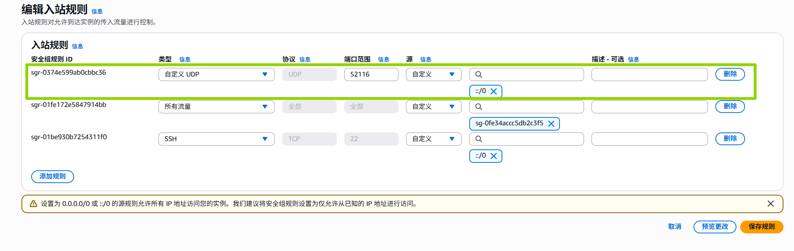
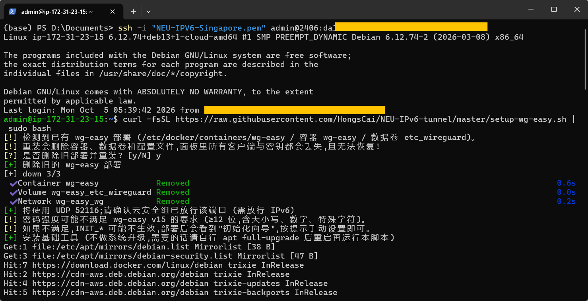
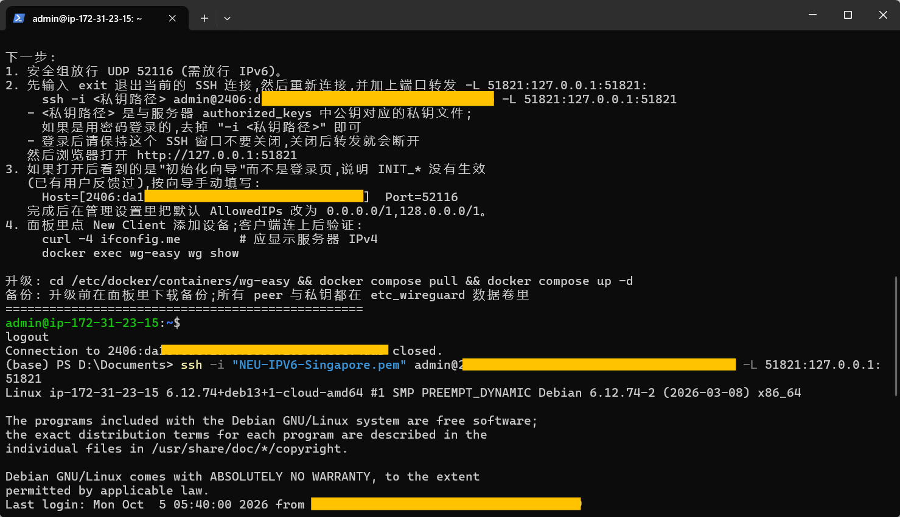
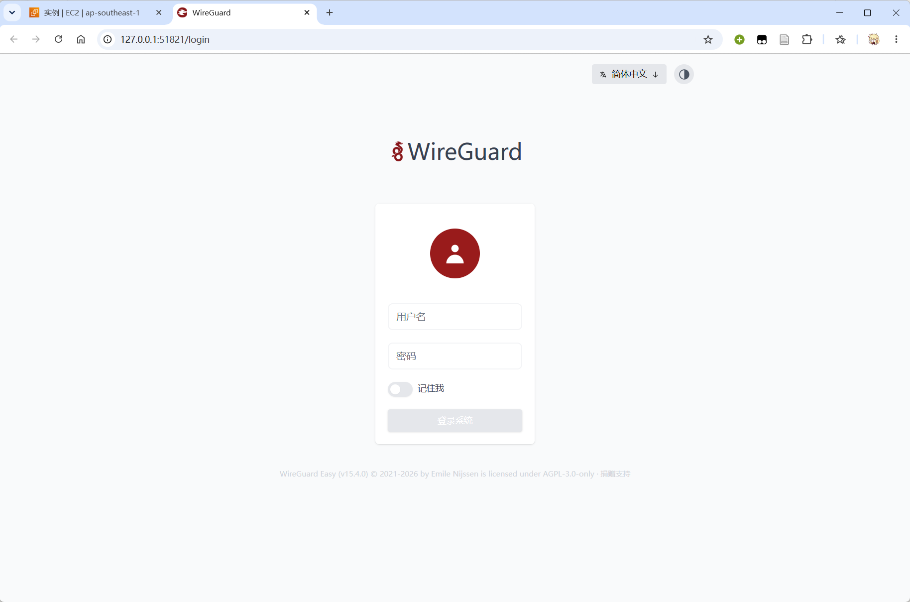
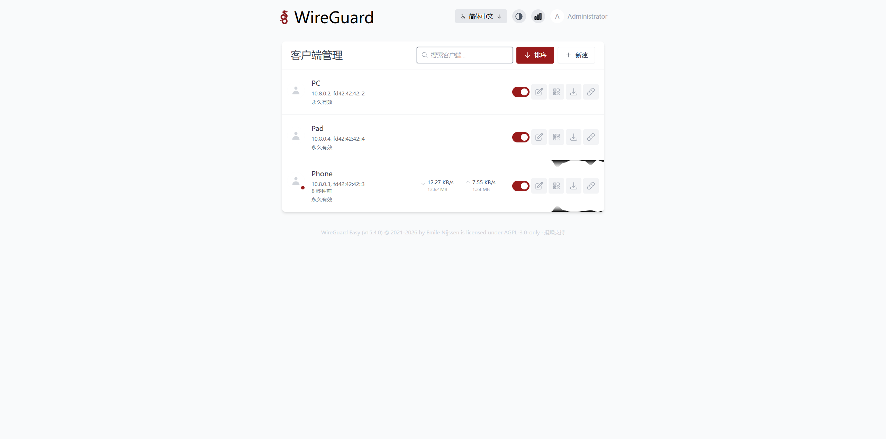
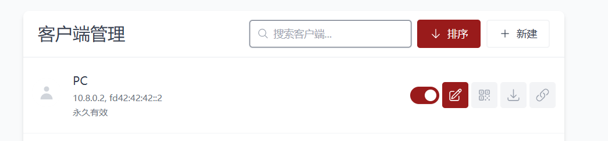
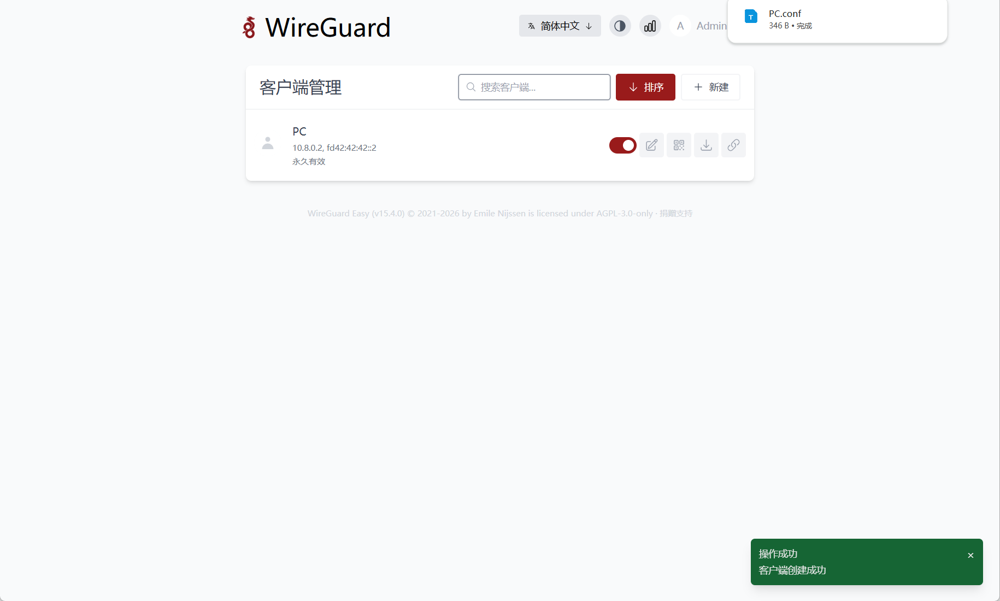
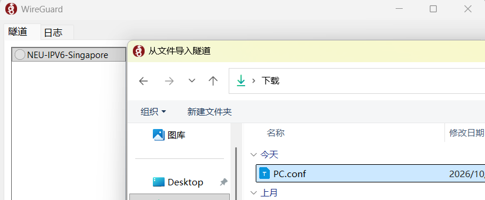
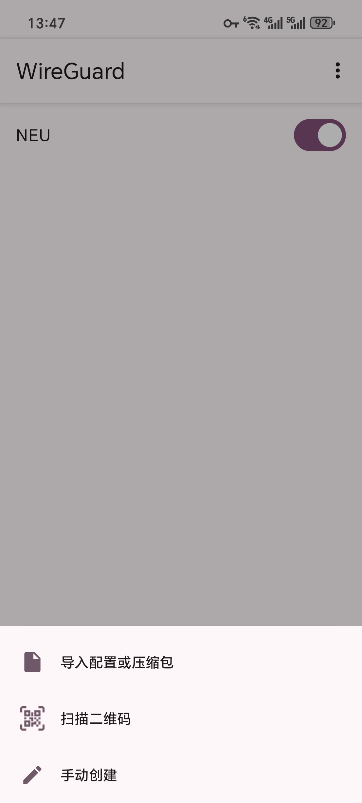

# NEU-IPv6-tunnel


## WireGuard 简单部署

利用教育网 IPv6 免流的特点，用 WireGuard 把电脑的 IPv4 流量封装进 IPv6 隧道，发往云服务器，再由服务器的 IPv4 出口访问互联网。


```
客户端
  |
  | IPv6 UDP WireGuard
  |
  ↓
云服务器 (IPv6 Endpoint)
  |
  | WireGuard Tunnel (IPv4 only)
  |
  ↓
公网 IPv4 出口
  |
  ↓
Internet
```


- 校园教育网里只看到电脑与服务器之间的 IPv6 流量。
- 只转发电脑的 IPv4 流量，IPv6 流量照常直连，不经过隧道。
- 服务器上用 wg-easy 管理客户端，面板只监听本机，通过 SSH 转发访问。


### 前置工作

准备好一个云服务器（有公网IPv6）

> AWS 可以免费用一年【建议云服务器使用 新加坡的 香港的被严肃风控】 【有100GB的出站流量免费额度】
>
> Azure 可以GitHub学生认证免费用一年


云服务器的安全组放行 UDP `52116`  （需放行 IPv6）


### 服务端部署

登录自己的云服务器

>例如下面用私钥登录
>
>```shell
>ssh -i "NEU-IPV6-Singapore.pem" admin@2406:da1x:xxxx:xxxx:xxxx:xxxx:xxxx:xxxx
>```


直接运行

```bash
curl -fsSL https://raw.githubusercontent.com/HongsCai/NEU-IPv6-tunnel/master/setup-wg-easy.sh | sudo bash
```

默认自动探测服务器 IPv6，WireGuard 端口 `52116`，账号 `admin` / `123456789123` 。


>如果要自定义运行可以带参数运行：
>
>改动了 port 的话需要调整上面云服务器的安全组放行的 port
>
>```bash
>curl -fsSL https://raw.githubusercontent.com/HongsCai/NEU-IPv6-tunnel/master/setup-wg-easy.sh | sudo bash -s -- --port 52116 --password 'Your-Passw0rd!'
>```
>
>| 选项                    | 默认值                   | 说明                             |
>| ----------------------- | ------------------------ | -------------------------------- |
>| `--host`                | 自动探测 IPv6            | 客户端连接的域名或地址           |
>| `--port`                | `52116`                  | WireGuard UDP 端口               |
>| `--user` / `--password` | `admin` / `123456789123` | 面板账号                         |
>| `--dns`                 | `1.1.1.1`                | 客户端 DNS                       |
>| `--ipv4-cidr`           | `10.8.0.0/24`            | 隧道 IPv4 网段                   |
>| `--allowed-ips`         | `0.0.0.0/1,128.0.0.0/1`  | 客户端默认 AllowedIPs            |
>| `--harden-ssh`          | 关                       | 禁用 SSH 密码登录 (需已配置公钥) |
>| `--reinstall`           | 关                       | 已有部署时不询问，直接删除重装   |





部署后

先 `exit` 退出当前 SSH 连接，再建立 SSH 转发 (登录后保持窗口不要关闭)：

```bash
ssh -i <私钥路径> root@<服务器IPv6> -L 51821:127.0.0.1:51821
```


用密码登录的话可以去掉  `-i <私钥路径>`



然后浏览器打开 [http://127.0.0.1:51821](http://127.0.0.1:51821/)


### 管理面板配置



默认账号：admin

默认密码：123456789123




新建客户端



在客户端配置的高级选项中 MTU建议设置为 1360，一些浏览器图片加载不出来的时候可以适当调低 1360 -> 1340 -> 1320

> 给电脑使用的客户端建议保活间隔设置为 25，手机去设置貌似有点费电


### 客户端导入

> WireGuard 的客户端下载连接：https://www.wireguard.com/install/
>
> 安卓可以直接在google play里下载到


电脑通过下载的conf配置文件导入






手机平板直接扫码导入即可




然后就可以美美上网咯


### 管理

重装：再次运行脚本，按提示确认即可 (会清空旧数据)。服务器重启后会自动启动。


如果在重启前手动执行过 `docker stop wg-easy`，重启后它不会自动起来。要恢复就执行 `docker start wg-easy`，之后正常重启就又会自启了。


```shell
# 升级
cd /etc/docker/containers/wg-easy && docker compose pull && docker compose up -d

# 卸载 (会删除所有客户端)
cd /etc/docker/containers/wg-easy && docker compose down -v
rm -rf /etc/docker/containers/wg-easy /root/wg-easy-credentials.txt
```


## 3X-UI 部署

使用 3x-ui 配置 IPv4 和 IPv6 两个 Hysteria2 入站，由同一个客户端生成一份 Clash 订阅。在校园网有可用原生 IPv6 时，选择 IPv6 节点连接服务器。校外只有 IPv4 时，改选 IPv4 节点。两种节点都能使用服务器的 IPv4 和 IPv6 出口。

| 方案 | 客户端 | 默认分流 |
| --- | --- | --- |
| 上面的 WireGuard | WireGuard | IPv4 经服务器转发，IPv6 保持直连 |
| 3x-ui + Hysteria2 | Clash Verge Rev / Clash Meta for Android | TUN 模式下普通公网 IPv4 和国外 IPv6 走代理，国内 IPv6 由 Mihomo 直连。系统代理模式下按国内外规则分流 |

### 前置工作

1. 准备一台支持公网 IPv4、原生公网 IPv6 和 UDP 入站的 Linux 云服务器。IPv4 经云平台 NAT 时，入站绑定本机 IPv4，订阅填写公网 IPv4。
2. 准备两个域名，IPv4 域名使用 A 记录，IPv6 域名使用 AAAA 记录。为两个域名配置 HTTPS 证书。

| 端口 | 用途 |
| --- | --- |
| `49606/UDP` | 两条 Hysteria2 入站，放行 IPv4 和 IPv6 |
| `2096/TCP` | HTTPS Clash 订阅，放行 IPv4 和 IPv6 |
| `15087/TCP` | HTTPS 管理面板，限制到管理来源，并设置随机访问路径，放行 IPv4 和 IPv6 |
| `80/TCP` | 使用 HTTP-01 签发和续期证书时放行，放行 IPv4 和 IPv6 |

SSH 沿用服务器已有的管理端口。若云平台做端口转发，同时检查转发规则、云防火墙和主机防火墙。

### 服务端部署

- [手动部署手册](./docs/3x-ui-hysteria2.md)包含 DNS、证书、双入站、Xray 出站规则、完整 Clash YAML，以及验收和回滚步骤。
- [AI 部署 Prompt](./docs/3x-ui-hysteria2-prompt.md)可单独交给能操作本机终端的 AI。它会先问 SSH 连接方式，再确认域名和公网入口，收齐信息后按步骤部署。仓库中的示例使用占位符，实际密码和订阅链接请另行保存。

### 让 Agent 使用本项目

在能调用本机终端的 Agent 中打开本仓库，或把下面整段复制到新对话。Agent 会先询问你怎么从本机 SSH 登录，做只读预检后再问域名、公网地址和证书，信息齐备后开始部署。

~~~text
请使用 https://github.com/HongsCai/NEU-IPv6-tunnel 为我部署 3x-ui + Hysteria2。
如果当前工作区已打开这个仓库，直接读取本地文件。否则从仓库获取以下两个文档。
- 把 docs/3x-ui-hysteria2-prompt.md 作为本次任务的部署指令。
- 把 docs/3x-ui-hysteria2.md 作为配置、排查和回滚参考。

先问我从这台电脑 SSH 连接服务器的方式。只读预检通过后，再问域名、公网地址、证书和校园网选项。收齐信息后按 Prompt 备份、部署并验收。遇到已有服务或端口冲突，先说明影响，让我决定。请沿用本机配置好的 SSH 凭据。
~~~

如果 Agent 读不到仓库，把 [AI 部署 Prompt](./docs/3x-ui-hysteria2-prompt.md) 下载后发给它即可。Agent 能读取文档且本机可以 SSH 登录时，才可代你执行远程部署。

### 客户端导入与切换

1. 用当前网络能访问的 HTTPS 订阅地址导入配置。订阅下载域名和代理节点可分别选择，两个下载入口都应提供同一组节点。
2. 在 Clash 选择「规则」模式和「连接方式」。校园网原生 IPv6 可用时选 IPv6，校外只有 IPv4 时选 IPv4。电脑按需开启 TUN 或系统代理，手机用 Android VPN 模式开启 TUN。
3. 有 WireGuard 的设备先断开 WireGuard，再测试 Clash。服务器可以并行保留两套服务，WireGuard 继续用原来的 UDP `52116`，Hysteria2 默认用 UDP `49606`。验证两条新节点和校园门户后，再决定是否停用 WireGuard。
